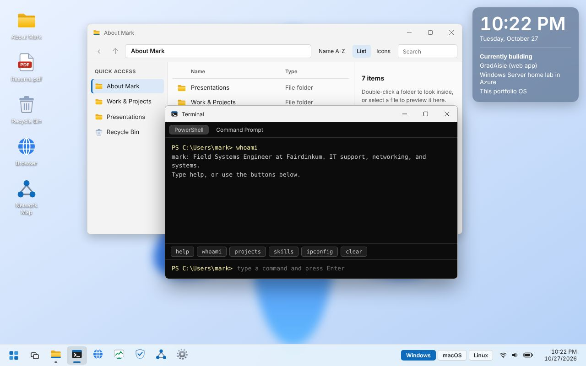
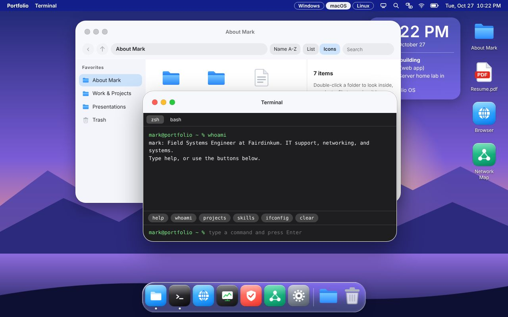
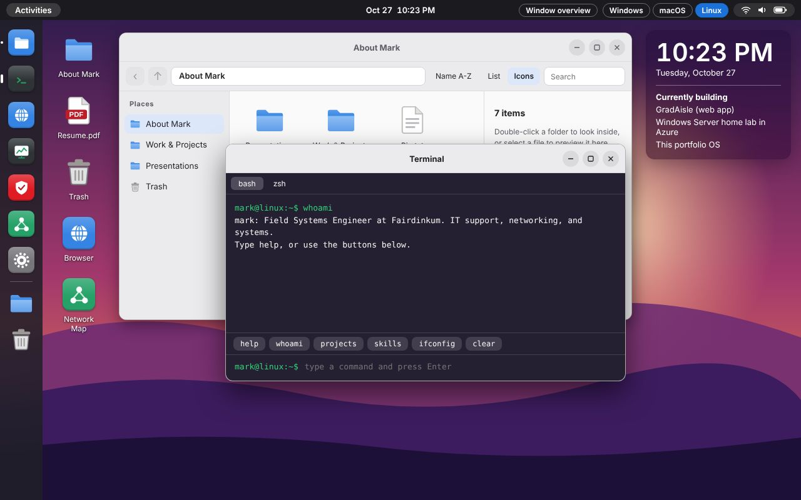
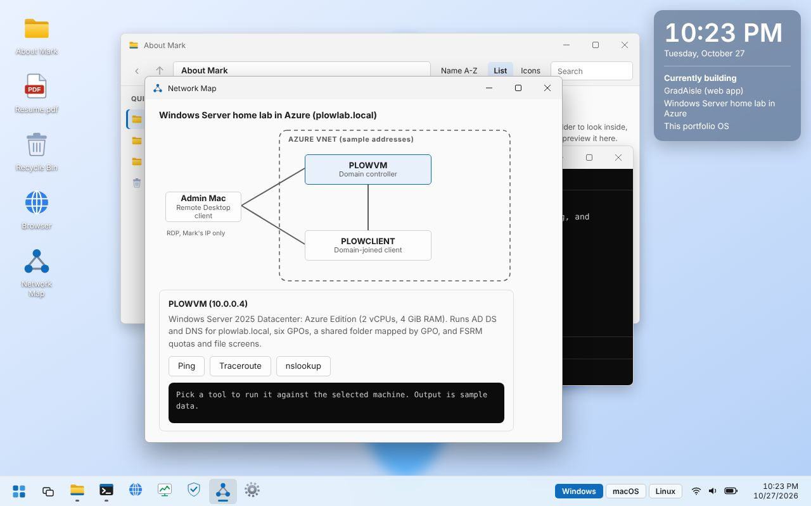
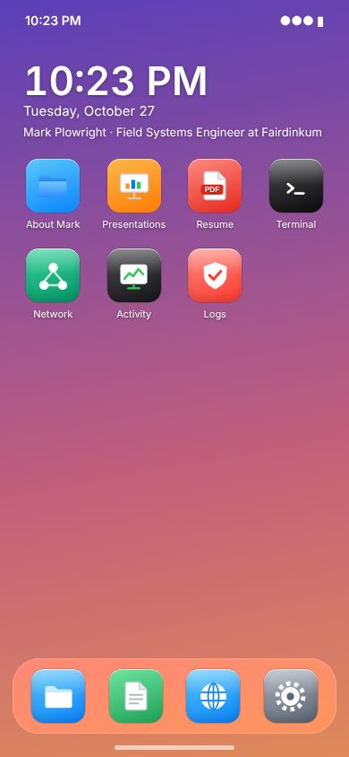

# Mark Leslie Plowright OS

Mark Plowright's portfolio, shaped like a desktop operating system in the browser. Live at **https://markplowwright.github.io/**.

Each project, presentation and document is something you open in a window: a file explorer for the portfolio, a terminal, a network map of the Azure home lab, a task manager, an event viewer with sample security alerts, a links browser and settings. The whole desktop can switch between a **Windows**, **macOS** or **Linux** look without losing open windows. On phones it becomes a home screen of app icons.

| Windows | macOS | Linux |
|---|---|---|
|  |  |  |

| Network Map | Phone |
|---|---|
|  |  |

Screenshots live in `docs/screenshots/`. The design mock-up references are in `docs/reference/`.

## How it works

### Window manager (`src/os/`)

- **`windowStore.ts`** is a small Zustand store holding a list of windows. Each `WindowState` has its position and size (`x`, `y`, `w`, `h`), focus order `z`, and `minimized`, `maximized` and `snap` flags. Every change goes through an action: `openApp`, `closeWindow`, `focusWindow`, `minimizeWindow`, `toggleMaximize`, `moveWindow`, `resizeWindow`, `snapWindow`.
  - Focusing a window gives it the highest `z` so far plus one, which puts it on top.
  - Opening a `singleInstance` app that is already open focuses it instead of opening a second window.
  - Snapping and maximizing never change `x/y/w/h`, only how the window is drawn, so restoring needs no extra state.
- **`useWindowDrag.ts`** handles dragging and resizing with Pointer Events. On pointer down it captures the pointer and remembers the start position. Each move adds the distance to that start and calls the store. On release at the left or right screen edge it snaps the window to that half; at the top edge it maximizes. Dragging a snapped or maximized window pulls it back to its floating size.
- **`Window.tsx`** works out the rectangle to draw (floating, snapped or maximized, kept on screen) and renders the current skin's `WindowFrame` around the app.
- **`Desktop.tsx`** draws the wallpaper, desktop icons, widget, windows, the skin's shell and the shared overlays: context menu, quick settings and calendar, toasts, window switcher, boot and lock screens.
- State is saved to `localStorage` under one versioned key, `mp-portfolio-v1` (see `storage.ts`). Saved values are checked when loaded. The lock screen is never saved.
- URL parameters: `?skin=windows|mac|linux` picks a look; `?open=<app or file id>` skips the lock screen and opens something directly, for example `?open=resume`, `?open=network` or `?open=p-homelab`.
- Keyboard: `Alt` + `` ` `` opens the window switcher, `Esc` closes menus, and in Files `Enter` opens the selected item.

### Skins (`src/os/skins/`)

A skin changes how things look and where controls sit, never what the system does. Each skin is a `Skin` object (`skins/types.ts`) with a `WindowFrame`, a `Shell` (taskbar and start menu / menu bar, dock and Spotlight / top bar, dock and Activities), terminal prompts, the space its bars take (`insets`), a few words that differ (Recycle Bin / Trash) and a `tokens.css` file.

All colors, radii and shadows are CSS variables, set per skin and per light/dark mode on `<html data-skin data-mode>`. Apps only use the variables, so they follow the skin automatically. App state lives in stores, so switching skins keeps every window and its content.

### Content (`src/content/`)

All portfolio text is here and nowhere else: `profile.ts`, `projects.ts`, `presentations.ts`, `skills.ts`, `fileTree.ts` (built from the others), `events.ts`, `lab.ts`, `links.ts`, `tips.ts`, `terminal.ts` and `wallpapers.ts`. Open placeholders are listed in `docs/TODO-CONTENT.md`.

## Tech stack

Vite, React 19 and TypeScript (strict), Zustand for state, plain CSS with variables, Vitest for tests. No UI library, no backend. Each app loads as its own small file the first time it is opened. Every dependency is recorded in `docs/LICENSES.md`.

## Run and build

```bash
npm install
```

```bash
npm run dev
```

```bash
npm test
```

```bash
npm run build
```

`npm run build` type-checks and writes the site to `dist/`. Pushing to `main` runs `.github/workflows/deploy.yml`, which tests, builds and publishes `dist/` to GitHub Pages. In the repository settings, Pages › Source must be set to **GitHub Actions**.

## How to add things

### An app

1. Create `src/apps/<name>/index.tsx` with a default-exported component that takes `{ windowId }`. Keep its state in a small store if it should survive a skin switch.
2. Add the id to `AppId` in `src/os/types.ts`.
3. Add one entry to `apps` in `src/os/appRegistry.ts` (titles per skin, icon, default size, `singleInstance`, `pinned`).

The taskbar, dock, start menu, search, switcher and `?open=` pick it up automatically. Put any text in `src/content/`.

### A skin

1. Make `src/os/skins/<name>/` with `WindowFrame.tsx`, `Shell.tsx`, `tokens.css` (the CSS variables for light and dark, plus the shell's styles) and `index.ts` exporting a `Skin`.
2. Add the id to `SkinId` in `src/os/types.ts` and to `SKIN_IDS` in `src/os/skinStore.ts`.
3. Register it in `src/os/skins/index.ts`, and add its icon colors in `src/os/AppIcon.tsx` and its wallpapers in `src/content/wallpapers.ts`.

### A wallpaper

Add an entry to the skin's list in `src/content/wallpapers.ts`: a `name`, a drawing `style` (`bloom`, `dusk` or `hills`), its colors, and a `license`. The test fails if `license` is missing or empty. For a photo, use only your own or one whose license allows it, and record it in `docs/LICENSES.md`.

### A project or presentation

Add an entry to `src/content/projects.ts` or `src/content/presentations.ts` and put any files in `public/`. The Files app, terminal, search, browser and phone layout all read from these lists.
